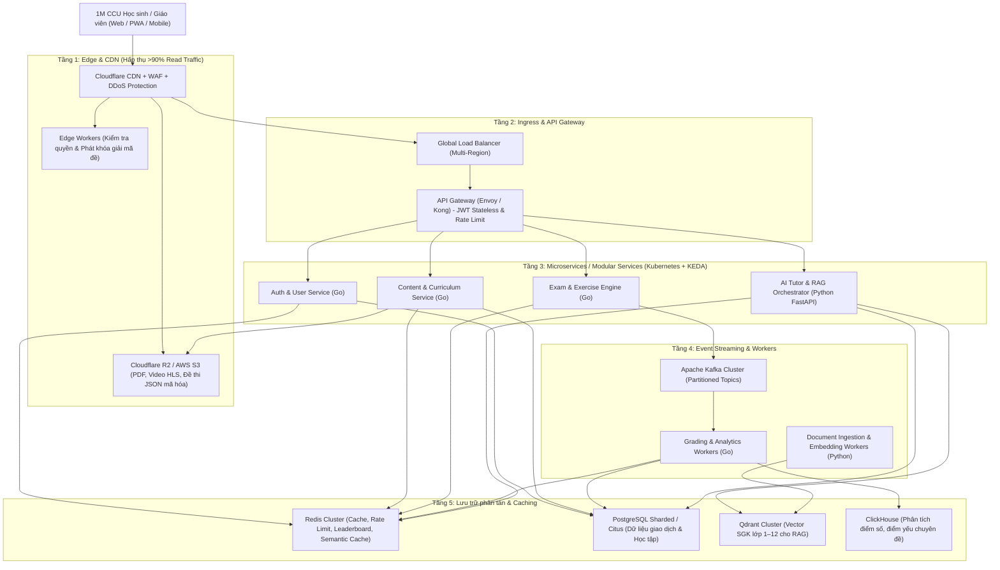
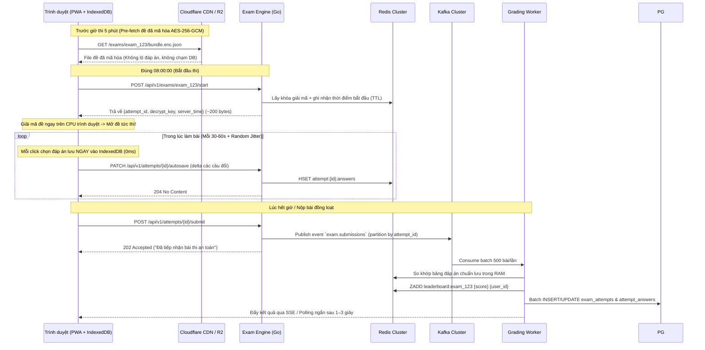
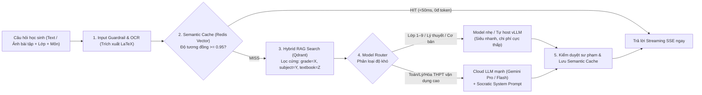

# 01. Kiến trúc Hệ thống Giáo dục K–12 (Chịu tải 1.000.000 CCU)

Tài liệu thiết kế kiến trúc kỹ thuật cho nền tảng giáo dục từ lớp 1 đến lớp 12 bao gồm: **Tài liệu học tập**, **Thi trắc nghiệm trực tuyến**, **Làm bài tập trực tuyến**, và **AI dạy học (AI Tutor)** với mục tiêu vận hành mượt mà ở mức **1.000.000 người dùng truy cập đồng thời (1M CCU)**.

---

## 1. Ước tính tải & Capacity Planning (1M CCU)

Giả định phân bố lưu lượng trong giờ cao điểm (ví dụ: kỳ thi thử THPT Quốc gia hoặc giờ ôn tập buổi tối 19h–21h):

| Phân hệ | Tỷ lệ CCU | Hành vi trung bình | Lưu lượng đỉnh (Peak RPS / Connections) |
|---|---|---|---|
| **Tài liệu học tập & Video** | 45% (450.000) | Đọc bài, tải PDF, xem video HLS | ~150.000 RPS (95%+ hit tại CDN Edge) |
| **Thi trắc nghiệm đồng loạt** | 30% (300.000) | Mở đề cùng giây, lưu nháp, nộp bài | ~300.000 RPS burst lúc mở đề/nộp bài; ~10.000 RPS lưu nháp (nhờ jitter 30–60s) |
| **Làm bài tập trực tuyến** | 15% (150.000) | Làm từng câu, chấm ngay, xem lời giải | ~30.000 RPS |
| **AI dạy học (AI Tutor)** | 10% (100.000) | Chat streaming SSE, hỏi bài qua ảnh | ~25.000–50.000 kết nối SSE đồng thời; ~3.000–5.000 truy vấn mới/giây |

### Mục tiêu hiệu năng (SLA / SLO)
- **Độ sẵn sàng (Availability):** 99.95% (tối đa ~21 phút downtime/tháng).
- **Độ trễ (Latency P95):**
  - Trang tài liệu / đề thi tĩnh qua CDN: `< 80 ms`
  - API xác thực / nộp bài vào hàng đợi: `< 120 ms`
  - AI Tutor — Time to First Token (TTFT): `< 150 ms` (nếu trúng Semantic Cache), `< 1.200 ms` (nếu gọi LLM).
- **Mất dữ liệu bài thi (Data Loss):** `0%` (bảo vệ 2 lớp: `IndexedDB` phía trình duyệt + `Kafka` bền vững 3 bản sao phía server).

---

## 2. Kiến trúc tổng thể (High-Level Architecture)

---

## 3. Thiết kế chống giật lag cho 4 luồng nghiệp vụ trọng yếu

### 3.1. Luồng Thi trắc nghiệm đồng loạt (Chống Thundering Herd 300.000 người cùng bấm)

Thay vì để 300.000 học sinh truy vấn `SELECT * FROM questions` trực tiếp vào Database lúc 08:00:00:

**Tại sao kiến trúc này chịu được 1M CCU?**
1. **Tách biệt hoàn toàn tải đọc đề khỏi Database:** File đề mã hóa được phục vụ từ hàng trăm Edge PoP của CDN.
2. **Không bao giờ mất bài khi rớt mạng:** Mọi thao tác chọn đáp án lưu trực tiếp trong `IndexedDB` của trình duyệt; nếu mất Wi-Fi, học sinh vẫn làm tiếp và tự đồng bộ khi có mạng lại.
3. **Nộp bài không sập DB:** Kafka hấp thụ được hàng triệu message/giây; Worker kéo về chấm theo nhịp độ ổn định (backpressure) mà PostgreSQL chịu được.

---

### 3.2. Luồng AI dạy học (AI Tutor — Nhanh, Đúng chương trình 1–12, Tối ưu chi phí)

**Các nguyên tắc sư phạm & kỹ thuật bắt buộc:**
- **Ràng buộc theo lớp học (Grade-Locked RAG):** Truy vấn Qdrant luôn bắt buộc lọc metadata `grade_id` (1–12) và `curriculum` (GDPT 2018) để AI không dùng kiến thức cấp trên giải cho học sinh cấp dưới.
- **Chế độ Socratic (Gợi mở):** Mặc định không đưa đáp án cuối ngay mà chia thành 3 bước: *Xác định dạng bài → Gợi ý công thức/bước đầu → Kiểm tra lại bài làm của học sinh*.
- **Giới hạn tài nguyên công bằng (Fair-use Token Bucket):** Rate limit theo từng `user_id` trên Redis (ví dụ: tài khoản thường 30 lượt/ngày, tài khoản Pro không giới hạn nhưng chống spam 10 req/phút).

---

### 3.3. Luồng Tài liệu học tập (Lớp 1–12)
- **Nội dung bài học:** Lưu trữ dưới dạng MDX/Markdown + công thức LaTeX (render bằng **KaTeX** tại build-time/ISR).
- **Cache đa tầng:**
  - L1: Browser Cache + Service Worker (`Cache-Control: public, s-maxage=86400, stale-while-revalidate=604800`).
  - L2: CDN Edge Cache (Cloudflare).
  - L3: Redis Cluster cho metadata bài học và danh sách mục lục.
- **Tài liệu PDF & Video:** Lưu trên Cloudflare R2 / S3, phân phối qua Signed URL ngắn hạn (chống hotlink/cào hàng loạt) hoặc HLS chunked streaming cho video bài giảng.

---

### 3.4. Luồng Làm bài tập trực tuyến & Học thích ứng (Adaptive Practice)
- Học sinh chọn bài tập theo **Bài học / Chuyên đề / Mức độ (Nhận biết → Vận dụng cao)**.
- Hỗ trợ 4 dạng câu hỏi chuẩn GDPT 2018 mới nhất:
  1. `single_choice`: Trắc nghiệm 1 đáp án đúng (A/B/C/D).
  2. `multi_choice`: Trắc nghiệm nhiều đáp án đúng.
  3. `true_false_group`: Trắc nghiệm Đúng/Sai 4 ý (chuẩn đề thi THPT từ 2025).
  4. `short_answer`: Trả lời ngắn / điền số.
- **Cập nhật hồ sơ năng lực (Mastery Score):** Sau mỗi bài tập, sự kiện đẩy về Kafka → Worker cập nhật điểm thành thạo từng chuyên đề (ví dụ: *Toán 12 - Tích phân: 62%*) vào PostgreSQL và ClickHouse để gợi ý bài luyện tập tiếp theo và cung cấp ngữ cảnh cho AI Tutor.

---

## 4. Chiến lược mở rộng Cơ sở dữ liệu (Database Scaling)

| Bảng / Nhóm dữ liệu | Tốc độ tăng trưởng | Chiến lược Scale |
|---|---|---|
| `grades`, `subjects`, `chapters`, `lessons` | Rất nhỏ (~50.000 dòng) | Cache 100% trên Redis + CDN; hầu như không cần đọc DB. |
| `questions`, `exams` | Trung bình (~2–5 triệu câu hỏi) | PostgreSQL Primary + Read Replicas; cache đề thi thành static JSON trên R2. |
| `exam_attempts`, `attempt_answers` | **Cực lớn (Hàng tỷ dòng)** | **Partition theo thời gian (`created_at` theo tháng)** + **Sharding theo `user_id`** (dùng Citus hoặc TiDB). |
| `ai_conversations`, `ai_messages` | **Cực lớn** | Partition theo tháng; lưu lịch sử cũ > 90 ngày sang Object Storage lạnh (Parquet/S3). |
| Báo cáo điểm số, thống kê giáo viên | Truy vấn tổng hợp nặng | Đồng bộ bất đồng bộ từ Kafka sang **ClickHouse** để truy vấn báo cáo tức thì mà không ảnh hưởng DB chính. |

---

## 5. Bảo mật & Chống gian lận thi cử cơ bản

1. **Chống lộ đề & đáp án:** Đáp án đúng (`correct_answer`) **không bao giờ** gửi xuống client trong file đề thi hoặc API lấy đề; chỉ tồn tại trên server và Redis nội bộ của Grading Worker.
2. **Trộn đề & trộn đáp án:** Mỗi `attempt_id` có một `seed` ngẫu nhiên để xáo thứ tự câu hỏi và thứ tự phương án A/B/C/D.
3. **Giám sát phiên thi (Proctoring nhẹ, không gây lag):** Ghi nhận sự kiện chuyển tab (`visibilitychange`), thoát toàn màn hình, copy/paste và gửi kèm gói autosave định kỳ (không mở thêm kết nối thừa).
4. **Xác thực không trạng thái (Stateless Auth):** Dùng Access Token (JWT Ed25519/RS256, thời hạn 15 phút) + Refresh Token lưu Redis (hỗ trợ thu hồi khi đăng nhập thiết bị mới).
